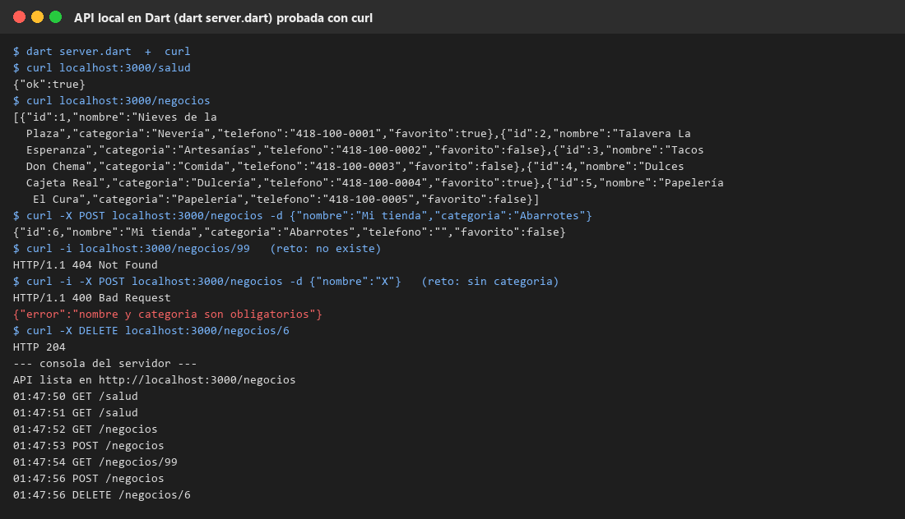
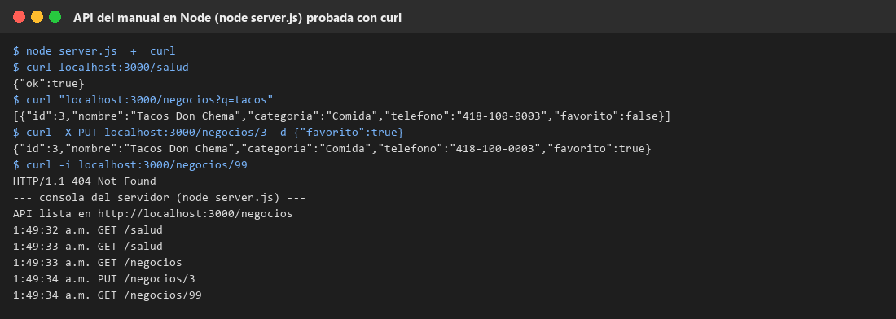
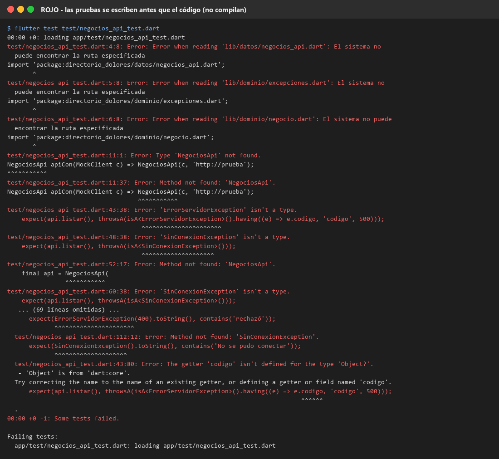
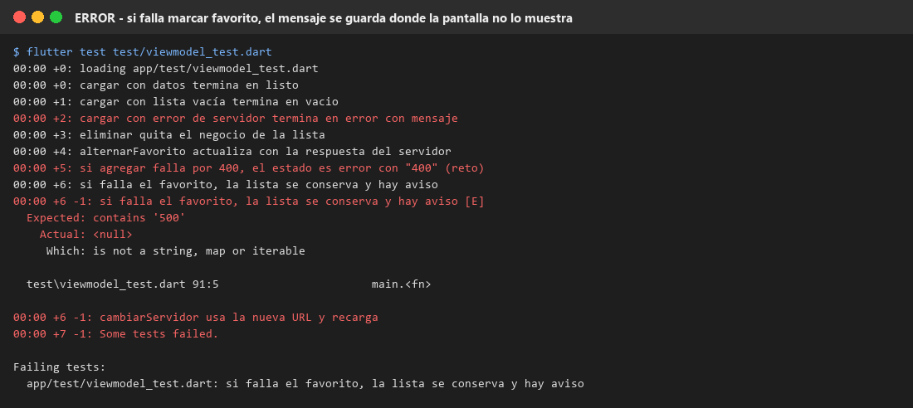
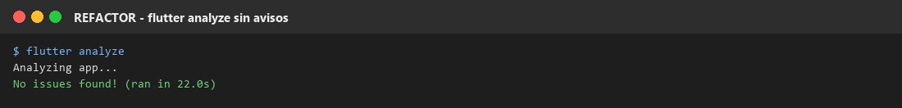
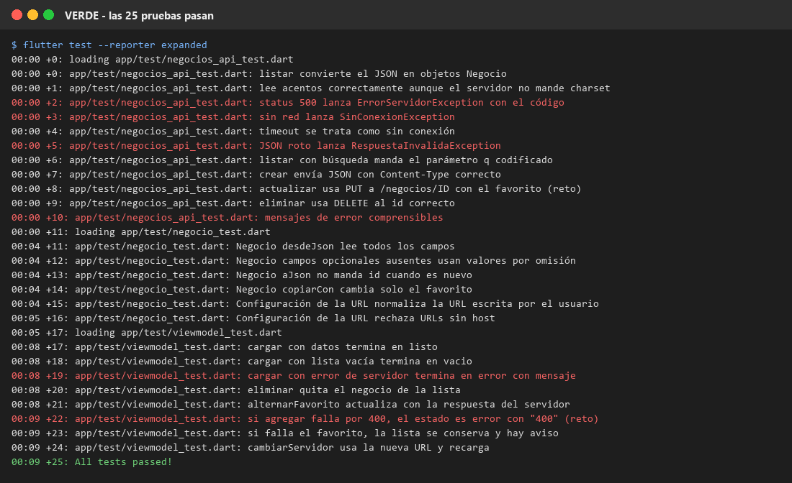
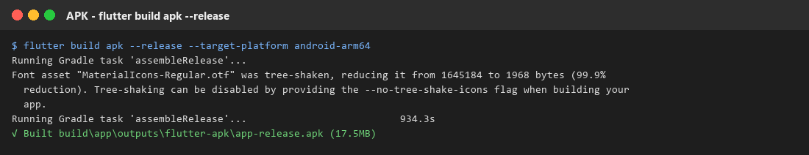

# Directorio Dolorense — app Flutter que consume una API local

Directorio de negocios de Dolores Hidalgo. Una **API REST local** (en tu computadora) guarda los negocios y la app los
lista, agrega (POST), marca favoritos (PUT) y elimina (DELETE). Construida con **TDD** siguiendo el *Manual paso a paso
con TDD — Consumo de una API local*: cliente HTTP probado con `MockClient` (sin red), los 5 estados de pantalla
(inicial, cargando, listo, vacío, error) y errores traducidos a mensajes claros.

**Mejora sobre el manual:** la dirección del servidor se puede cambiar **desde la app** (ícono 🖧) y se recuerda,
así el mismo APK sirve en el emulador (`10.0.2.2`) y en un celular real (IP de tu PC) sin recompilar.

---

## 📦 APK

| Archivo | Ruta |
|---|---|
| Lista para instalar | `apk/DirectorioDolores.apk` (17.5 MB) |
| Salida de Flutter | `build/app/outputs/flutter-apk/app-release.apk` |

```bash
flutter build apk --release --target-platform android-arm64
```

El APK es para teléfonos **arm64** (prácticamente todos los Android de los últimos años). Para instalar: copia el `.apk` al teléfono, ábrelo y acepta *instalar apps de origen desconocido*.

La app necesita que el servidor esté encendido en tu computadora y que el celular esté en **la misma red Wi-Fi**.
En la app toca 🖧 y escribe `http://IP-DE-TU-PC:3000` (la IP la ves con `ipconfig`).

---

## 🏗️ Estructura

```
directorio_dolores/
├── api/
│   ├── server.js        API del manual (Node, sin dependencias)
│   └── server.dart      la MISMA API en Dart (viene con Flutter: no hay que instalar Node)
└── app/
    ├── lib/dominio/       negocio · excepciones
    ├── lib/datos/         negocios_api (MockClient-friendly) · config_api (URL + normalizar)
    ├── lib/presentacion/  negocios_viewmodel (5 estados) · pantalla_negocios
    └── test/              negocio_test · negocios_api_test · viewmodel_test
```

---

## 🖥️ Servidor

Enciende **una** de las dos (son equivalentes):

```bash
cd ../api
node server.js
```

```bash
cd ../api
dart run server.dart
```

Ambas se probaron con `curl` (lista, búsqueda, alta, favorito, 404 y 400 del reto del manual, y borrado 204):





---

## 🔴🟢🔵 Evidencia del ciclo TDD

### 1. 🔴 ROJO — las pruebas se escriben primero y fallan

Las pruebas de `test/` se escribieron **antes** que el código. Al correr `flutter test` con `lib/` todavía vacía, nada compila:



### 2. ❌ Error real atrapado por una prueba

En el ViewModel del manual, si falla marcar un favorito (por ejemplo el servidor responde 500), el error se guarda en
`mensajeError`:

```dart
} catch (e) {
  mensajeError = e.toString();      // ❌ el estado sigue en "listo"
}
```

Pero la pantalla **solo muestra `mensajeError` en el estado de error**; como la lista sigue en "listo", el usuario toca
la estrella, no pasa nada y nunca se entera de por qué. La prueba *"si falla el favorito, la lista se conserva y hay
aviso"* lo atrapó:



**Corrección:** un campo `aviso` para errores que no deben tumbar la lista; la pantalla lo muestra en un SnackBar:

```dart
} catch (e) {
  aviso = e.toString();             // ✅ la lista se queda y aparece el aviso
}
```

> Nota: también se escribió una prueba para acentos sin `charset` en la respuesta; **pasó a la primera** porque la
> versión actual del paquete `http` ya decodifica JSON como UTF-8. Se conserva como protección.

### 3. 🔵 REFACTOR — limpiar sin romper nada

Con las pruebas en verde se ordenó el código y `flutter analyze` quedó sin avisos:



### 4. 🟢 VERDE — las 25 pruebas pasan



### 5. 📦 Compilación del APK



---

## ✅ Qué cubren las pruebas

| Grupo | Lo que se verifica |
|---|---|
| Modelo | leer todos los campos, opcionales con valores por omisión, `aJson` sin id, `copiarCon` |
| Cliente HTTP | GET/POST/PUT/DELETE con método, ruta y `Content-Type` correctos, búsqueda codificada (`nieve limón`) |
| Fallas | 500 → código, sin red, timeout, HTML en lugar de JSON, acentos, mensajes comprensibles |
| ViewModel | secuencia `[cargando, listo]`, vacío, error con mensaje, eliminar, favorito, 400 al agregar (reto), cambiar servidor |
| Configuración | normalizar la URL que escribe el usuario y rechazar direcciones sin host |

```bash
flutter test
```

---

## 📱 Capturas de la app

> Tomadas en un teléfono físico con el APK instalado. *Guarda tus capturas en `capturas/` con estos nombres y aparecerán aquí automáticamente.*

| Lista de negocios | Agregar negocio (POST) | Favorito (PUT) |
|---|---|---|
|  |  |  |

| Deslizar para borrar (DELETE) | Error: servidor apagado | Cambiar dirección del servidor |
|---|---|---|
|  |  |  |

### Qué probar en la app

| Caso | Qué hacer | Resultado esperado |
|---|---|---|
| Conectar | 🖧 → `http://IP-DE-TU-PC:3000` | Aparecen los 5 negocios |
| Agregar | Botón + con nombre y categoría | Aparece al final de la lista |
| Agregar inválido | Botón + sin categoría | "El servidor rechazó los datos enviados (400)." |
| Favorito | Toca la estrella | Se pinta ⭐ (y el servidor imprime `PUT`) |
| Sin servidor | Apaga el servidor y jala para recargar | Nube tachada y botón Reintentar |

---

## 🛠️ Cómo correr el proyecto

```bash
flutter pub get
```

```bash
flutter test
```

```bash
flutter run
```

